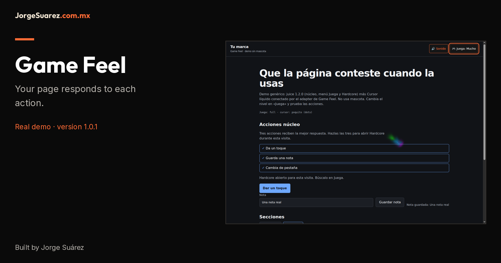

# Game Feel 1.0.1

[Español](README.md) · [English](README.en.md)



[Mobile cover](docs/media/cover.en.mobile.png)

A family of tools by Jorge Suárez. [Papacito Juice](https://github.com/jorgefsb/papacito-juice) · [Game Feel](https://github.com/jorgefsb/game-feel) · [Official brandkit](https://brandkit.jorgesuarez.com.mx/)

## What is it?

A method and generic adapter connecting juice responses to Cursor líquido through “Juega”. It does not require, download or add a mascot.

## Who is it for?

For designers and web teams who want responses to useful actions in their own identity, with their own mascot or none.

## Why was it made?

To give clear feedback when tapping, typing or saving, with one pointer owner and without choosing the visitor’s level for them.

## How do I use it?

First watch the [explained demonstration](docs/media/README.en.md). On an already integrated page open “Juega”, choose Poquito or Mucho, then tap, save a demonstration note and change tabs: those three actions unlock Hardcore in this demo.

## When should or shouldn’t I use it?

Use it when motion helps explain an action. Do not use it if it distracts, covers controls or requires another brand’s mascot.

## Where can I try or download it?

Code and issue tracking are in the [repository](https://github.com/jorgefsb/game-feel). The runnable demo is in [examples/](examples/index.html); a technical person must prepare its local server. There is no published npm package or hosted service verified in this review.

This library does not install itself into your site. If you only want to see it, ask the technical team to open the demo; the next section is for that team. Reduced motion forces Nada.

## What the demo shows


[MP4](docs/media/demo.mp4) · [Captions ES](docs/media/demo.es.vtt) · [Captions EN](docs/media/demo.en.vtt) · [Transcripción / Transcript](docs/media/README.en.md)

Real recording of `examples/`, Chromium with SwiftShader WebGL and real pointer events. This is not a physical-phone test or GPU performance benchmark. Text and notes are demonstration data.

| Juega | API | Cursor |
|---|---|---|
| Nada | `off` | Off; reduced motion |
| Poquito | `subtle` | 7 px dots, no WebGL |
| Mucho | `full` | Fluid, 10 CSS px radius |
| Hardcore | `hard` | Fluid, 18 CSS px radius |

The native pointer remains visible. The adapter hides the old Hardcore trail, not celebrations; those hidden nodes are still created. Fluid uses `screen` blending, looks best on dark backgrounds and may reduce quality or pause within its budget. There is no fifth stable level: [Legendario](docs/roadmap.en.md) is a proposal.

## Technical team: run and integrate

Requires Node.js 20+, npm, a modern browser and WebGL for fluid rendering. HTML/CSS/JS integration is required; this is not an end-user account service.

```sh
npm ci
npm run setup
npm run verify
npm run demo
# In another terminal
npm test
npx playwright install chromium
npm run test:browser
```

Open `/examples/` at the address printed by the server; stop with Ctrl+C. `setup` downloads pinned sources and verifies SHA-256. Downloads require network access; runtime files are served from the same origin. If a release is unavailable, do not change pins: use exact verified copies.

```sh
npm run setup -- --cursor-dir ruta/a/cursor-liquido/dist
```

`--juice-dir` accepts the same verified local core. Cursor líquido `dist` must be stable 1.0.1 with the exact manifest, JS and CSS; no fallback to older sources exists.

Serve juice 1.2.0 (core, menu, Hardcore), Cursor líquido 1.0.1 and `src/game-feel-cursor.{js,css}` from your origin. `GameFeelCursor.mount({ requireJuice: true })` reads `data-jz-level` without writing it. `destroy()` restores the previous compatibility attribute. Only six generic juice files and their manifest are downloaded: no Moki.

## Status, costs, privacy and help

This revision updates documentation: it does not change runtime, create a release or certify a deployment. The profile/adapter remains **1.0.1**; juice is **1.2.0**, commit `f1b3b9c77a43ffbcbd331bb88420a436614fdbc3`. [Setup pins](scripts/setup-demo.mjs) are authoritative; `verify` checks disk, bundle, renderer, adapter, guard and wrapper. The guard preserves pending input during quality reduction without changing shaders or budget.

Own code and instructions: [MIT](LICENSE), no license fee for this code. Integration, hosting and maintenance may cost money. The juice source declares no license at the pinned commit: do not assume redistribution permission. Signature, brand and Moki **are not MIT** or an asset license; see [NOTICES](NOTICES) and the [media notice](docs/ASSET-NOTICE.md). `vendor/` and original WEBP files are not committed.

The adapter sends no telemetry and reads no cookies. juice keeps level, sound and achievements in `localStorage`; Clear site data to erase them. Dependency downloads do contact their sources; analytics added by your site needs its own policy. See [privacy details](docs/privacy-license.en.md).

Help: open an [issue](https://github.com/jorgefsb/game-feel/issues) with version, browser, reproduction steps and error, without private data. No SLA or universal compatibility is promised. Emulated mobile tests do not replace physical-device tests.

## Guides and evidence

- [Integration and rollback](docs/integration.en.md)
- [Architecture](docs/architecture.en.md)
- [Principles](docs/design-principles.en.md)
- [Privacy and licensing](docs/privacy-license.en.md)
- [Proposals and known gaps](docs/roadmap.en.md)
- [Portable agent guide](docs/REPOSITORY-DOCUMENTATION.en.md)
- [Browser report](reports/browser-report.json) · [Media report](reports/media-report.json) · [Documentation verification](reports/docs-brandkit-verification.json)
