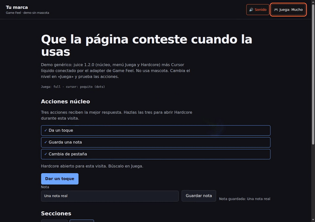
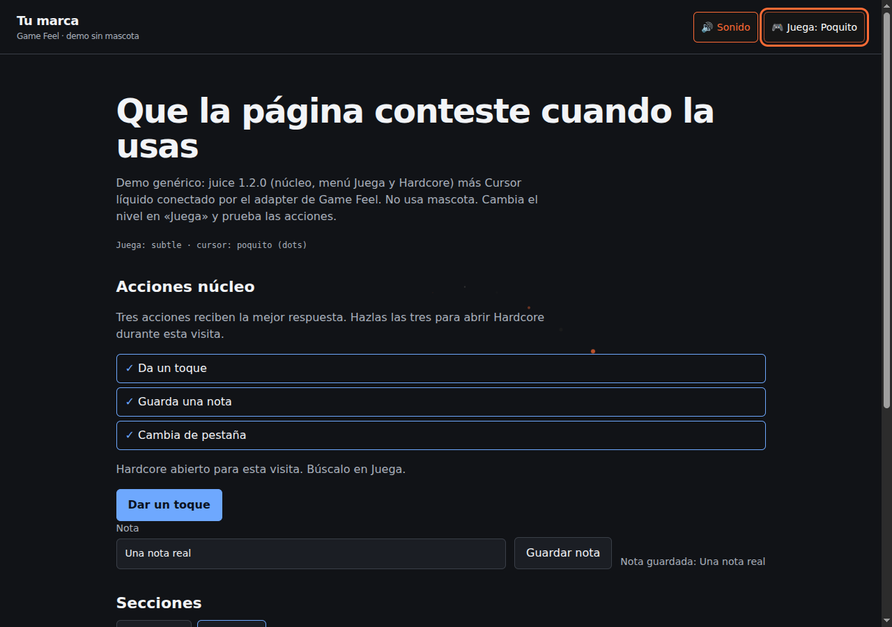
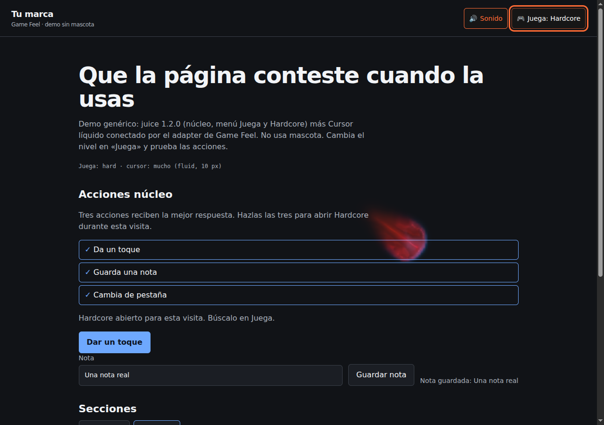

<div align="center">

<a href="https://github.com/jorgefsb/game-feel/releases/tag/v1.0.1"></a>

<br />

<a href="./README.md"></a>


<br />

**[▶ Ver la versión 1.0.1](https://github.com/jorgefsb/game-feel/releases/tag/v1.0.1)** · Más proyectos en [github.com/jorgefsb](https://github.com/jorgefsb)

</div>

---

<p align="center"></p>
<p align="center"><sub>Grabación real de <code>examples/</code>, con eventos reales del puntero. Chromium con WebGL por software. <a href="docs/media/demo.mp4">Ver el video MP4</a></sub></p>

## ¿Qué es?

Un método y un adaptador genérico para que una página responda a lo que haces. Conecta el menú «Juega» de juice con [Cursor líquido](https://github.com/jorgefsb/cursor-liquido), sin mascota obligatoria.

## ¿Para quién es?

Para equipos y marcas con sitio propio que quieren microinteracciones, sonido y estela de cursor con su propia identidad.

## ¿Qué dolor resuelve?

La mayoría de las páginas no responden: tocas, escribes o guardas y no pasa nada. Y cuando alguien les mete efectos, deciden por la persona: suenan sin permiso, tapan clics o no respetan a quien pidió menos movimiento.

## La propuesta

Tratar una página como se trata un juego. La persona abre «Juega» y elige cuánto responde el sitio. El adaptador respeta su elección de nivel y sonido, y nunca bloquea clics, escritura ni scroll.

| Juega | Valor | Qué pasa con el cursor |
|---|---|---|
| Nada | `off` | Sin efecto. Movimiento reducido fuerza este nivel |
| Poquito | `subtle` | Puntos de 7 px, sin WebGL |
| Mucho | `full` | Fluido con radio de 10 px |
| Hardcore | `hard` | Fluido con radio de 18 px |

| Poquito | Mucho | Hardcore |
|---|---|---|
|  |  |  |

## ¿Cómo se usa?

Para probarlo en tu máquina necesitas Node.js 20 o posterior:

```sh
npm ci
npm run setup
npm run demo
```

Abre la dirección que imprime el servidor y entra a `/examples/`.

Para ponerlo en otra página, sirve desde tu propio dominio juice 1.2.0, Cursor líquido 1.0.1 y `src/game-feel-cursor.{js,css}`, y llama:

```js
GameFeelCursor.mount({ requireJuice: true })
```

Ponerlo en un sitio requiere integración técnica. El orden de scripts y las opciones están en [docs/integration.md](./docs/integration.md).

## ¿Cuándo conviene y cuándo no?

Conviene cuando tienes una marca propia y quieres que tu sitio se sienta al tocarlo.

No conviene si lo que quieres es a Moki: eso es [Papacito Juice](https://github.com/jorgefsb/papacito-juice), y Moki no se licencia. Tampoco hay paquete en npm ni prueba en teléfonos físicos.

## ¿Dónde lo pruebo?

**[Versión 1.0.1](https://github.com/jorgefsb/game-feel/releases/tag/v1.0.1)** y la demo local de `examples/`. En vivo lo ves funcionando en [jorgesuarez.com.mx](https://jorgesuarez.com.mx), con el perfil de la marca personal.

## Hasta dónde llegamos

Versión 1.0.1, MIT. Cuatro niveles estables; no hay quinto. La suite cubre niveles, controles, desmontaje, móvil emulado, movimiento reducido y preferencias.

Límite conocido: en WebGL por software el motor puede bajar la calidad o pausarse si se pasa de su presupuesto.

## Para quien construye

```sh
npm run verify        # compara los archivos en disco contra hashes fijados
npm test
npm run test:browser
```

Versiones fijadas, garantías, arquitectura y principios: [guía técnica](./docs/GUIA-TECNICA.md), [arquitectura](./docs/architecture.md) y [principios](./docs/design-principles.md).

## Licencia

Código e instrucciones: [MIT](./LICENSE). Moki, su arte y la marca personal no son MIT y no se concede permiso de reutilización. Ver [NOTICES](./NOTICES).

---

<div align="center">

<sub>Hecho con amor ❤️🎮 por <a href="https://jorgesuarez.com.mx">JorgeSuarez.com.mx</a> · <a href="https://github.com/jorgefsb">Más proyectos</a> · <a href="./README.md">Read in English</a><br />Documentación actualizada el 10 nov 2026.</sub>

</div>
