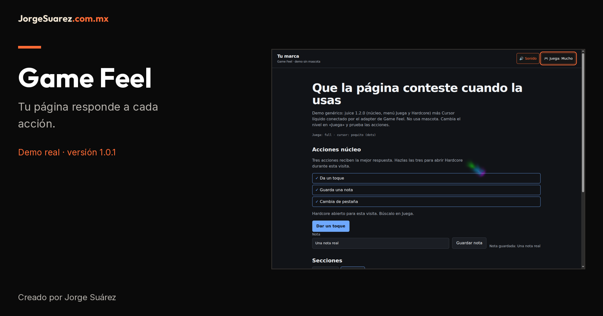
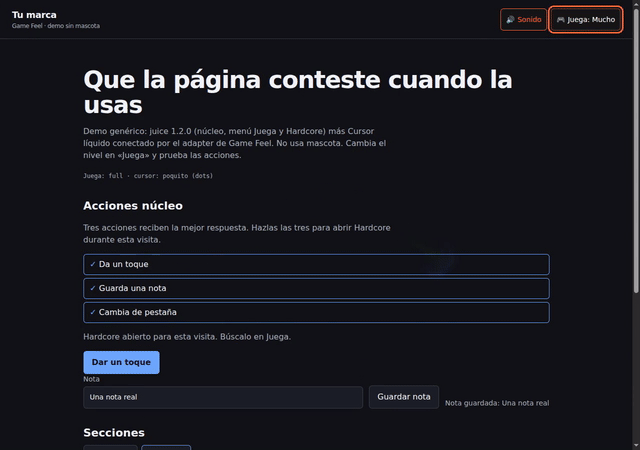

# Game Feel 1.0.1

[Español](README.md) · [English](README.en.md)



[Portada móvil](docs/media/cover.es.mobile.png)

Familia de herramientas de Jorge Suárez. [Papacito Juice](https://github.com/jorgefsb/papacito-juice) · [Game Feel](https://github.com/jorgefsb/game-feel) · [Brandkit oficial](https://brandkit.jorgesuarez.com.mx/)

## ¿Qué es?

Un método y adaptador genérico para conectar las respuestas de juice con Cursor líquido desde «Juega». No requiere, descarga ni añade mascota.

## ¿Para quién es?

Para diseñadores y equipos web que quieren respuestas a acciones útiles con su propia identidad, con mascota propia o sin ninguna.

## ¿Por qué existe?

Para dar una respuesta clara al tocar, escribir o guardar, con un solo dueño del puntero y sin decidir el nivel por el visitante.

## ¿Cómo lo uso?

Primero mira la [demostración explicada](docs/media/README.md). En una página ya integrada abre «Juega», elige Poquito o Mucho y prueba tocar, guardar una nota de demostración y cambiar de pestaña: esas tres acciones abren Hardcore en esta demo.

## ¿Cuándo conviene y cuándo no?

Úsalo cuando el movimiento ayude a entender una acción. No lo uses si distrae, tapa controles o exige una mascota ajena.

## ¿Dónde lo pruebo o descargo?

Código y seguimiento en el [repositorio](https://github.com/jorgefsb/game-feel). La demo ejecutable está en [examples/](examples/index.html); necesita un servidor local preparado por alguien técnico. No hay paquete npm publicado ni servicio alojado verificado en esta revisión.

Esta biblioteca no se instala sola en tu sitio. Si solo quieres verla, pide al equipo técnico que abra la demo; el siguiente apartado es para ese equipo. Movimiento reducido fuerza Nada.

## Lo que muestra la demo



[MP4](docs/media/demo.mp4) · [Captions ES](docs/media/demo.es.vtt) · [Captions EN](docs/media/demo.en.vtt) · [Transcripción / Transcript](docs/media/README.md)

Grabación real de `examples/`, Chromium con WebGL por SwiftShader, eventos reales de puntero. No es una prueba en teléfono físico ni una medida de rendimiento GPU. Texto y notas: datos de demostración.

| Juega | API | Cursor |
|---|---|---|
| Nada | `off` | Apagado; movimiento reducido |
| Poquito | `subtle` | Puntos de 7 px, sin WebGL |
| Mucho | `full` | Fluido, radio 10 px CSS |
| Hardcore | `hard` | Fluido, radio 18 px CSS |

El puntero nativo queda visible. El adaptador oculta la estela vieja de Hardcore, no las celebraciones; esos nodos ocultos aún se crean. El fluido usa mezcla `screen`, se aprecia mejor sobre oscuro y puede bajar calidad o pausarse por presupuesto. No hay quinto nivel estable: [Legendario](docs/roadmap.md) es propuesta.

## Equipo técnico: ejecutar e integrar

Requiere Node.js 20+, npm, navegador moderno y WebGL para el fluido. Necesita integración HTML/CSS/JS; no es un servicio listo para cuentas finales.

```sh
npm ci
npm run setup
npm run verify
npm run demo
# En otra terminal
npm test
npx playwright install chromium
npm run test:browser
```

Abre `/examples/` en la dirección que imprime el servidor; termina con Ctrl+C. `setup` descarga fuentes fijadas y comprueba SHA-256. Requiere red para esa descarga; el runtime sirve todo desde el mismo origen. Si el release no está accesible, no cambies pins: usa copias exactas verificadas.

```sh
npm run setup -- --cursor-dir ruta/a/cursor-liquido/dist
```

`--juice-dir` admite el mismo núcleo local verificado. El `dist` de Cursor líquido debe ser el estable 1.0.1 con manifest, JS y CSS exactos; no existe fallback a fuentes antiguas.

Sirve juice 1.2.0 (núcleo, menú, Hardcore), Cursor líquido 1.0.1 y `src/game-feel-cursor.{js,css}` desde tu origen. `GameFeelCursor.mount({ requireJuice: true })` lee `data-jz-level`, no lo escribe. `destroy()` restaura el atributo previo de compatibilidad. Solo se descargan los seis archivos genéricos de juice y su manifest: sin Moki.

## Estado, costos, privacidad y ayuda

Esta revisión es documentación local: no publica versiones ni verifica un despliegue. El perfil/adaptador sigue en **1.0.1**; juice es **1.2.0**, commit `f1b3b9c77a43ffbcbd331bb88420a436614fdbc3`. Los pins de [setup](scripts/setup-demo.mjs) mandan; `verify` valida disco, bundle, renderer, adapter, guard y wrapper. El guard preserva input pendiente al bajar calidad sin cambiar shaders ni presupuesto.

Código propio e instrucciones: [MIT](LICENSE), sin tarifa de licencia de este código. Integración, alojamiento y mantenimiento pueden costar. El origen de juice no declara licencia en el commit fijado: no asumas permiso de redistribución. Firma, marca y Moki **no son MIT**, ni una licencia de assets; ver [NOTICES](NOTICES) y [aviso de medios](docs/ASSET-NOTICE.md). `vendor/` y los WEBP originales no se versionan.

El adaptador no envía telemetría ni lee cookies. juice conserva nivel, sonido y logro en `localStorage`; Se borran al limpiar datos del sitio. La descarga de dependencias sí contacta sus fuentes; cualquier analítica añadida por tu sitio requiere su propia política. Detalles en [privacidad](docs/privacy-license.md).

Ayuda: abre un [issue](https://github.com/jorgefsb/game-feel/issues) con versión, navegador, pasos y error sin datos privados. No hay SLA ni compatibilidad universal prometida. Pruebas de navegador en móvil emulado no sustituyen pruebas en equipos físicos.

## Guías y evidencia

- [Integración y rollback](docs/integration.md)
- [Arquitectura](docs/architecture.md)
- [Principios](docs/design-principles.md)
- [Privacidad y licencias](docs/privacy-license.md)
- [Propuestas y pendientes](docs/roadmap.md)
- [Guía portable para agentes](docs/REPOSITORY-DOCUMENTATION.md)
- [Browser report](reports/browser-report.json) · [Media report](reports/media-report.json) · [Documentation verification](reports/docs-brandkit-verification.json)
