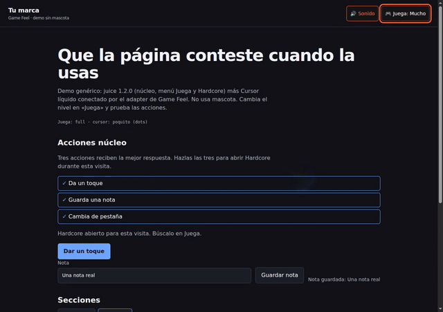
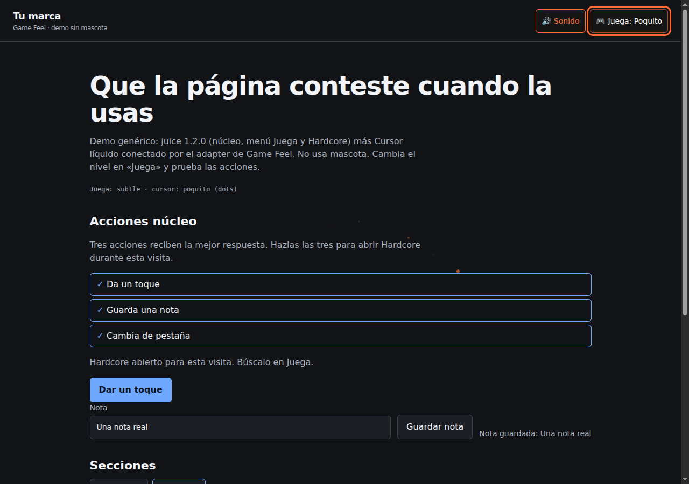
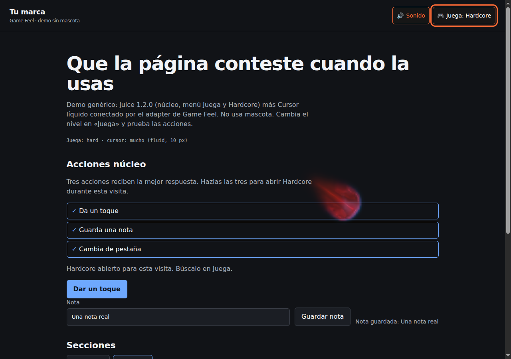

<div align="center">

<a href="https://github.com/jorgefsb/game-feel/releases/tag/v1.0.1"></a>

<br />


<a href="./README.es.md"></a>

<br />

**[▶ See version 1.0.1](https://github.com/jorgefsb/game-feel/releases/tag/v1.0.1)** · More projects at [github.com/jorgefsb](https://github.com/jorgefsb)

</div>

---

<p align="center"></p>
<p align="center"><sub>Real recording of <code>examples/</code>, with real pointer events. Chromium with software WebGL. <a href="docs/media/demo.mp4">Watch the MP4 video</a></sub></p>

## What is it?

A method and a generic adapter that make a page respond to what you do. It connects the juice «Juega» menu with [Cursor líquido](https://github.com/jorgefsb/cursor-liquido), with no mascot required.

## Who is it for?

For teams and brands with their own site who want microinteractions, sound and a cursor trail in their own identity.

## What pain does it solve?

Most pages do not respond: you tap, type or save and nothing happens. And when someone adds effects, they decide for the person: they play sound without permission, cover clicks or ignore people who asked for less motion.

## The proposal

Treat a page the way you treat a game. The person opens «Juega» and chooses how much the site responds. The adapter respects their level and sound choice, and never blocks clicks, typing or scrolling.

| Juega | Value | What the cursor does |
|---|---|---|
| Nada | `off` | No effect. Reduced motion forces this level |
| Poquito | `subtle` | 7 px dots, no WebGL |
| Mucho | `full` | Fluid with a 10 px radius |
| Hardcore | `hard` | Fluid with an 18 px radius |

| Poquito | Mucho | Hardcore |
|---|---|---|
|  |  |  |

## How do I use it?

To try it on your machine you need Node.js 20 or later:

```sh
npm ci
npm run setup
npm run demo
```

Open the address the server prints and go to `/examples/`.

To put it on another page, serve juice 1.2.0, Cursor líquido 1.0.1 and `src/game-feel-cursor.{js,css}` from your own domain, then call:

```js
GameFeelCursor.mount({ requireJuice: true })
```

Putting it on a site takes technical integration. Script order and options are in [docs/integration.md](./docs/integration.md) (in Spanish).

## When it fits and when it doesn't

It fits when you have your own brand and want your site to respond to touch.

It does not fit if what you want is Moki: that is [Papacito Juice](https://github.com/jorgefsb/papacito-juice), and Moki is not licensed. There is no npm package and no test on physical phones.

## Where can I try it?

**[Version 1.0.1](https://github.com/jorgefsb/game-feel/releases/tag/v1.0.1)** and the local demo in `examples/`. You can see it working live at [jorgesuarez.com.mx](https://jorgesuarez.com.mx), with the personal brand profile.

## How far we got

Version 1.0.1, MIT. Four stable levels; there is no fifth. The suite covers levels, controls, unmounting, emulated mobile, reduced motion and preferences.

Known limit: on software WebGL the engine may lower quality or pause if it goes over its budget.

## For builders

```sh
npm run verify        # compares files on disk against pinned hashes
npm test
npm run test:browser
```

Pinned versions, guarantees, architecture and principles, in Spanish: [technical guide](./docs/GUIA-TECNICA.md), [architecture](./docs/architecture.md) and [principles](./docs/design-principles.md).

## License

Code and instructions: [MIT](./LICENSE). Moki, his art and the personal brand are not MIT and no reuse permission is granted. See [NOTICES](./NOTICES).

---

<div align="center">

<sub>Made with love ❤️🎮 by <a href="https://jorgesuarez.com.mx">JorgeSuarez.com.mx</a> · <a href="https://github.com/jorgefsb">More projects</a> · <a href="./README.es.md">Leer en español</a><br />Documentation updated on 10 Nov 2026.</sub>

</div>
