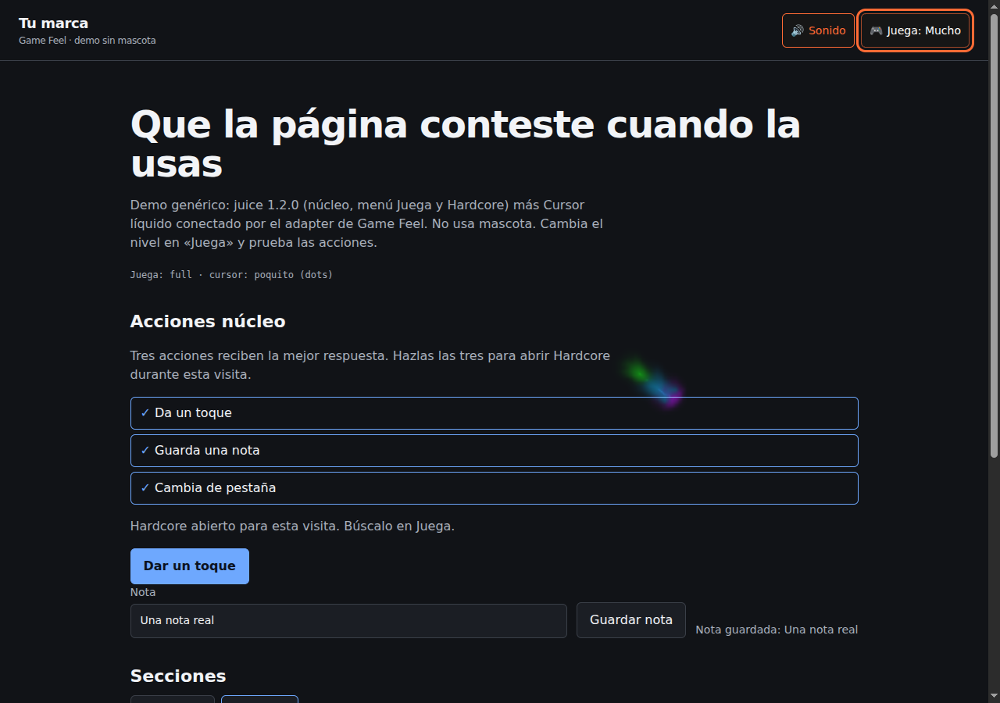
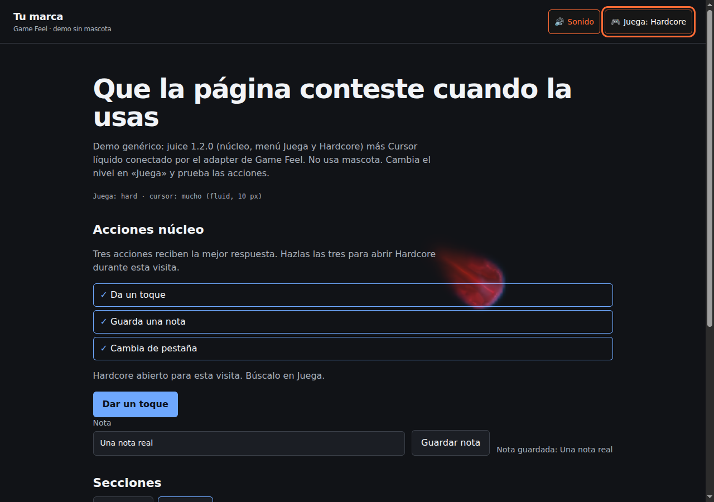

# Game Feel: explained demonstration

[Español](README.md) · [English](README.en.md) · [← README](../../README.en.md)

[MP4](demo.mp4) · [GIF](demo.gif) · [Captions ES](demo.es.vtt) · [Captions EN](demo.en.vtt) · [Player](player.html)

Existing recording reused without modification: 13.88 s, H.264, 1280 × 900, 25 fps, no audio track. Captions are editorial descriptions, not transcription of a nonexistent voice.

Reproducible source: `scripts/capture-demo.mjs`, `examples/` page, real pointer events in Chromium + SwiftShader. Original PNG/GIF/MP4 files remain identical to baseline. No simulated ink or engine-budget modification. This is not evidence of physical-phone performance.

## Descriptive transcript

- **0–2.5 s:** Generic demo: tap, save a note and switch tabs.
- **2.5–4 s:** Completing the three actions unlocks Hardcore, without a mascot.
- **4–10 s:** Mucho: pointer movement draws real fluid over the page.
- **10–13.88 s:** Hardcore: larger radius; controls and native pointer remain visible.

## Screenshots and interpretation

**Poquito:** original 7 px dots, no WebGL.

**Mucho:** 10 CSS px fluid following real pointer events.

**Hardcore:** 18 CSS px fluid; the achievement has already been completed in the recording.

Game Feel does not use Moki or download a mascot.

Sample notes and content are demonstration data, not customer information. Demo UI is Spanish; captions and this explanation provide ES/EN without pretending the UI was translated. To respect reduced motion, view the PNGs instead of the GIF.

[Artwork and brand notice](../ASSET-NOTICE.md)
